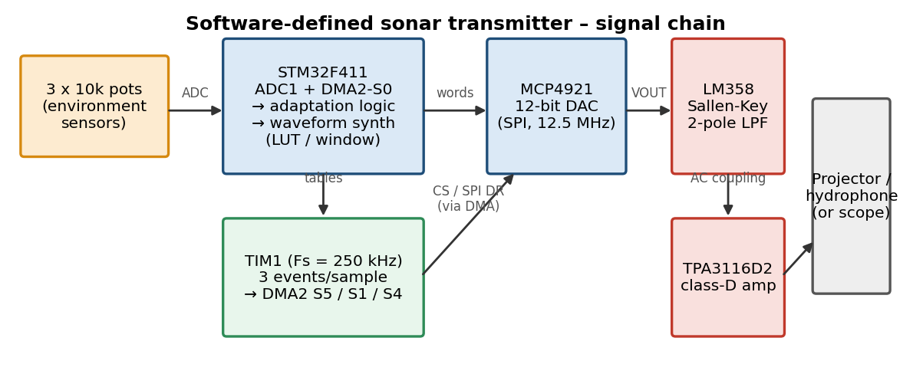

# Software-Defined Sonar Transmitter for AUVs

A physical, low-power **software-defined sonar transmitter payload** built on an STM32F411 "Black Pill", plus a **handheld oscilloscope** (NUCLEO-F446RE + TFT) used to verify the transmitted pulse.

The transmitter reads three potentiometers that stand in for environmental sensors ("muddy estuary" ↔ "clear shallow reef"), then synthesises and plays an adapted sonar ping through an external DAC and an analog filter. The sample stream is moved by **hardware timers + DMA**, so the CPU sleeps while a pulse plays.

> **Demo scaling:** real AUV sonars use 100–500 kHz. The parts used here (LM358, MCP4921 over SPI, class-D amp) cannot do that, so the demo limits bandwidth to **25 kHz** (sweep stays inside 5–30 kHz). The mathematics is identical.



## Features

| Requirement (problem statement) | How it is met |
|---|---|
| Timers + DMA stream samples to the DAC | TIM1 raises 3 DMA requests per sample (CS low → SPI data → CS high); DMA2 streams 5/1/4 do the work |
| Multiple modulations on the fly | LFM chirp, geometric (exponential) sweep, phase-coded (Barker-13 / m-sequence BPSK); short press on KEY cycles them |
| Environmental inputs via ADC | 3 pots → ADC1 scan with DMA (8× averaged), re-read before every ping |
| Adapt bandwidth/centre frequency, pulse duration, amplitude | POT1 / POT2 / POT3 (ranges below) |
| Digital windowing | Hann, Hamming or Blackman (long press on KEY cycles them) |
| Analog filter + op-amp | 2-pole Sallen-Key low-pass on an LM358 |
| Low power | CPU in `WFI` sleep during pulses and between pings; ADC switched off between reads |
| Output validation | Oscilloscope / FFT, or the included NUCLEO scope (`firmware/scope`) |

### Parameter mapping (demo values)

| Pot | Pin | Controls | Range |
|---|---|---|---|
| POT1 | PA1 | Bandwidth + centre frequency | BW 5 → 25 kHz, f<sub>c</sub> 8 → 17.5 kHz |
| POT2 | PA2 | Pulse duration | 2 → 20 ms |
| POT3 | PA3 | Amplitude | 10 → 100 % of DAC full scale |

Sample rate 250 kHz, ping repeats every 100 ms. All of these are `#define`s at the top of `SonarTx.ino`.

## Repository layout

```
underwater-sonar-transmitter/
├── firmware/
│   ├── transmitter/SonarTx/SonarTx.ino    # STM32F411 Black Pill - the transmitter
│   └── scope/SonarScope/SonarScope.ino    # NUCLEO-F446RE - 1.5 MS/s scope with TFT
├── docs/
│   ├── PINOUT.md                          # every connection, both boards
│   ├── BUILD_AND_FLASH.md                 # Arduino IDE settings, hex export, STM32 programmer
│   ├── Sonar_Transmitter_Study_Guide.pdf  # maths: LFM, windows, DMA, filters, ...
│   ├── problem_statement.txt
│   └── images/
├── hardware/BOM.md                        # parts list
├── LICENSE
└── README.md
```

## Quick start

1. Wire the transmitter exactly as in [`docs/PINOUT.md`](docs/PINOUT.md).
2. Build and flash `SonarTx.ino` following [`docs/BUILD_AND_FLASH.md`](docs/BUILD_AND_FLASH.md).
3. Power up. The LED blinks once. Turn the pots; the next ping (≤100 ms later) uses the new settings.
4. Probe the **LM358 output (filter output)** with an oscilloscope, or feed it to the NUCLEO scope (see the warning below).

### Controls

| Action | Effect | LED feedback |
|---|---|---|
| Short press KEY (PA0, on-board) | Cycle modulation: LFM → Geometric → Phase-coded | 1 / 2 / 3 flashes |
| Long press KEY (≥ 0.8 s) | Cycle window: Hann → Hamming → Blackman | 1 / 2 / 3 flashes |

The NUCLEO scope: rotate the encoder to change vertical gain (x0.5 … x8), press it to reset to x1. The screen shows frequency, period, wavelength (speed of sound set by `WAVE_SPEED`) and Vpp.

## ⚠️ Connecting the transmitter to the scope

- The NUCLEO ADC input (PA0) accepts **0 – 3.3 V only**. Never connect the amplifier (TPA3116D2) output to it.
- Tap the signal at the **LM358 output / before the class-D amplifier**, and the signal must be centred at about 1.65 V (the DAC idles at mid-scale; if you AC-couple, add a divider bias of 1.65 V after the capacitor).
- Join the **grounds** of both boards.
- For a safe margin, use POT3 below maximum or a 10 k series resistor into PA0.

## Status / honesty notes

- `SonarTx.ino` was compile-checked for Cortex-M4 and its waveform code was validated on a PC (spectra and windows match the study guide), but the DMA/timer register setup has **not yet been verified on real hardware** by the author of this file. If something is off (no output), enable `DEBUG_SERIAL` and see the debug checklist in the study guide.
- `SonarScope.ino` is the unmodified scope firmware supplied by the project owner.
- The LM358 is slow (~0.3 V/µs slew rate); at the top of the sweep and full amplitude the output may look triangular. Lower POT3.

## Documentation

The [study guide PDF](docs/Sonar_Transmitter_Study_Guide.pdf) covers LFM mathematics, matched filtering, windows, sampling and DAC theory, Sallen-Key design, timer/DMA architecture, power budget and FFT validation, with a self-test question bank.

## License

MIT, see [LICENSE](LICENSE). Replace `YOUR NAME` in the license with your name.
